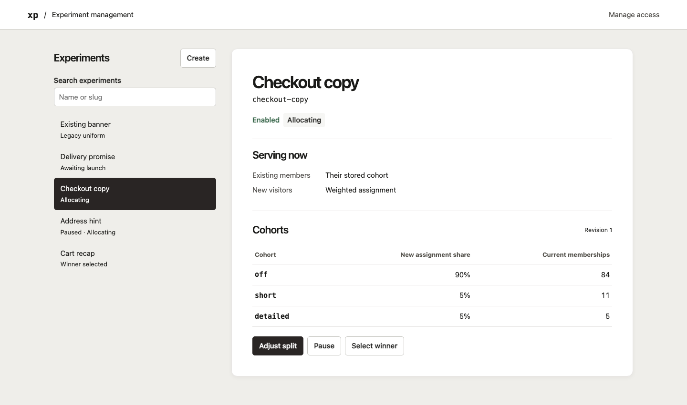
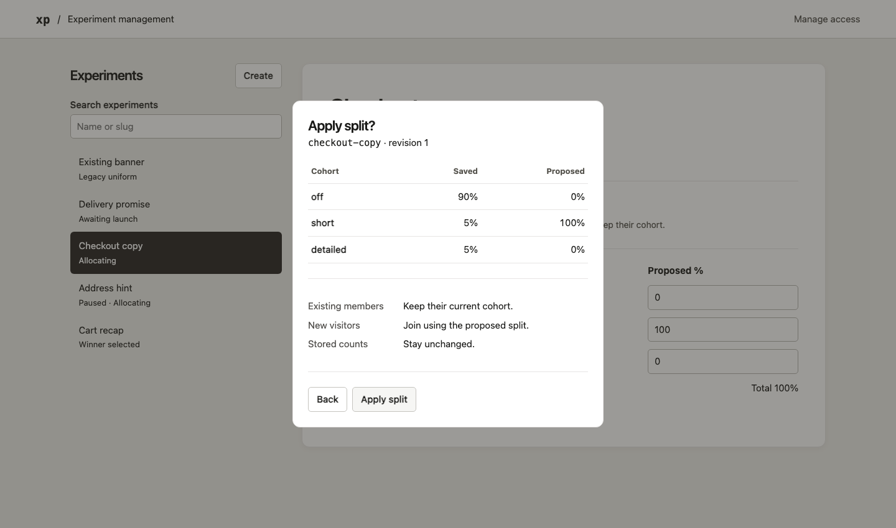
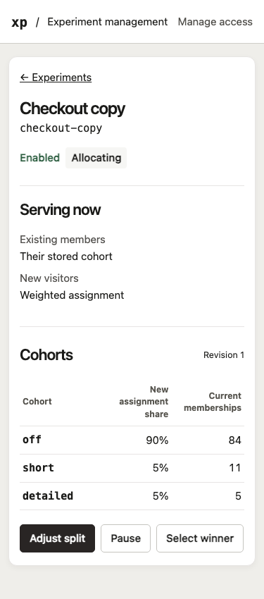

# Better Design · Directory inspector

The [interactive candidate](index.html#checkout-copy) opens locally with its styles in the same folder. Five synthetic experiments share a searchable directory. The detail starts with the effective decision for returning members and for new visitors. At 760 px and below the directory and selected record occupy separate screens. A link returns to search.

## Workflow

| Start                                                                                                                                                                  | Review task                                                                                                                                                                                                                                                                       |
| ---------------------------------------------------------------------------------------------------------------------------------------------------------------------- | --------------------------------------------------------------------------------------------------------------------------------------------------------------------------------------------------------------------------------------------------------------------------------- |
| [Running experiment](index.html#checkout-copy)                                                                                                                         | Adjust the split from 90/5/5 to 0/100/0. Review every saved and proposed share, the effect on newcomers and current members, and the stored counts. Back or Escape returns focus to Review split. Pause, resume and select off as winner. The 84/11/5 stored memberships survive. |
| [Empty installation](index.html?empty#directory)                                                                                                                       | Create checkout-copy with short and detailed treatments. Inspect the saved off pin and zero memberships, launch and check that the phase changes.                                                                                                                                 |
| [Awaiting launch](index.html#delivery-promise) · [Finished with off](index.html#cart-recap)                                                                            | Both serve the default. The phase and pin or winner label identify how each reached that result.                                                                                                                                                                                  |
| [Viewer](index.html?access=view#checkout-copy) · [Host creation disabled](index.html?disable-create#directory)                                                         | Inspect the data and the actions the host permits.                                                                                                                                                                                                                                |
| [Count error](index.html?error=counts#checkout-copy) · [Save failure](index.html?error=save#checkout-copy) · [Revision conflict](index.html?error=stale#checkout-copy) | Retry a failed counts read. In the split editor, submit once to exercise the failure. The saved and proposed shares remain visible. The conflict has a review-latest action before resubmission.                                                                                  |

## Provenance and selection

On 21 November 2026 the Better Design catalog returned Cobalt, Cerulean, Interior, Instrument and Linear. Interior's quiet light canvas, ink selected state and legible dense tables fit the host-embedded workflow. We exported its DTCG kit and used the light surface, foreground, action, focus and font-stack tokens in the local renderer. The prototype loads local assets and uses the system font fallback when Geist is absent. [Interior catalog](https://better-design.com/design-systems/interior)

Better Design's UI search recommended leading labels, trailing numeric values, and grouping by the operator's question. Its UX confirmation guidance recommended consequence-first wording and safe default focus. The native dialog implements those for the split and winner review. The dashboard structure tool reported its installed-component checks inapplicable to this local HTML proof. Its comprehension check passed the allocation confirmation copy. Screenshots and interaction results here come from local Chromium.

**Adopt the two audience rows.** They resolve the same support question in every phase, and can carry the consequences into confirmation. Keeping the directory open makes lateral comparison quick at a wide viewport. Its persistent width reduces the space for long identifiers. The mobile detail uses a full-width reading area and costs one navigation step to choose the next experiment.

Chromium exercised the full create-to-launch entry point, the 90/5/5 reweight review, cancel focus restoration, pause, resume, winner off, view-only access, failed counts, failed save and conflict recovery at 375, 768, 1024 and 1440 px. Visual inspection of the mobile capture prompted a wider cohort column. Edits live in the open document until reload. The prototype uses the supplied fixtures, with no backend or external analytics.
