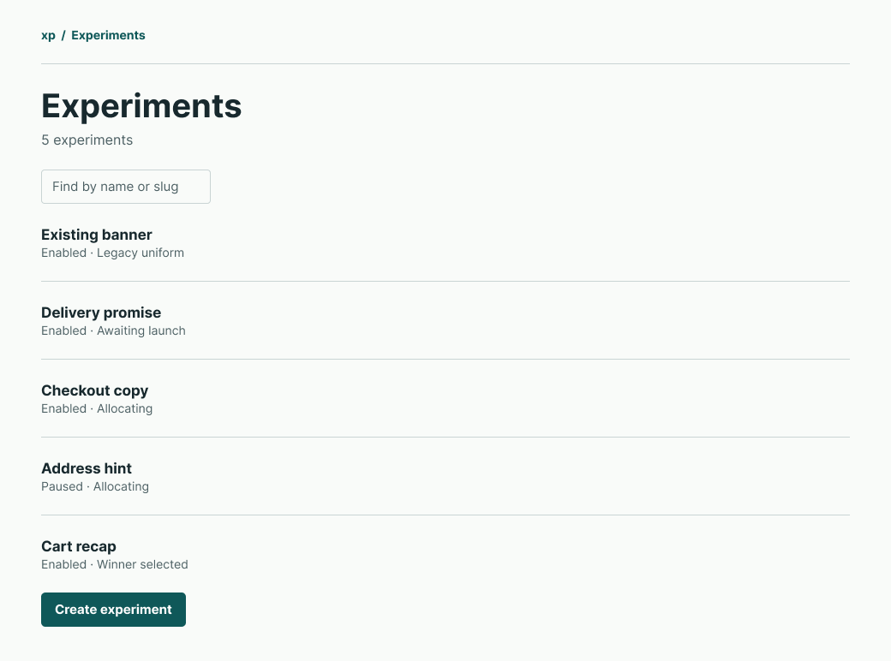
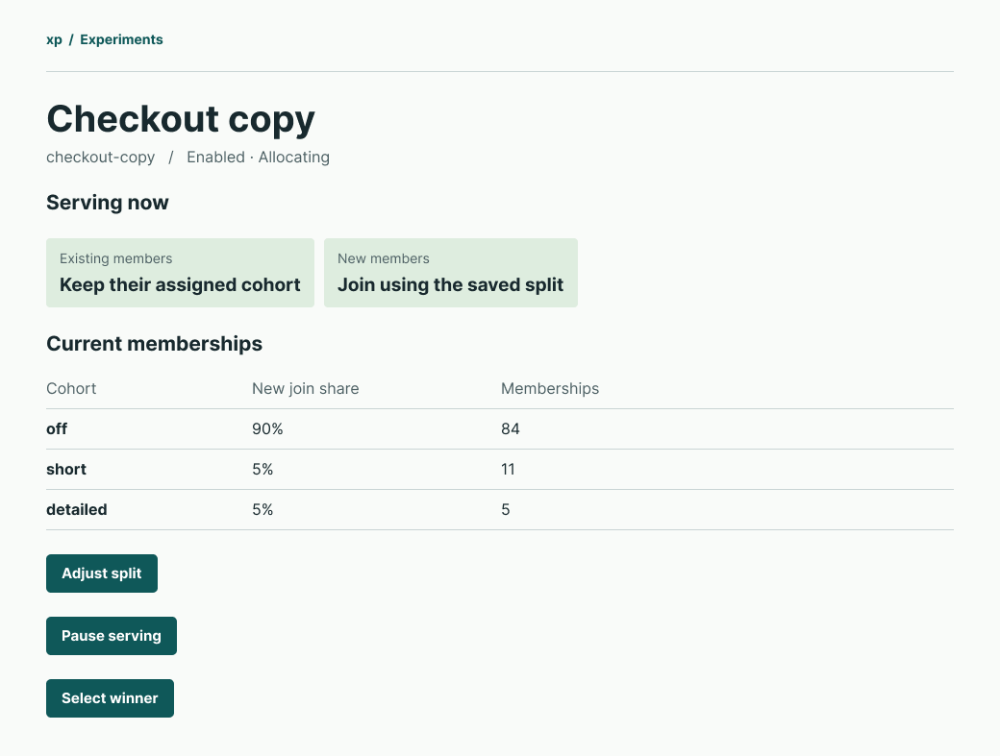
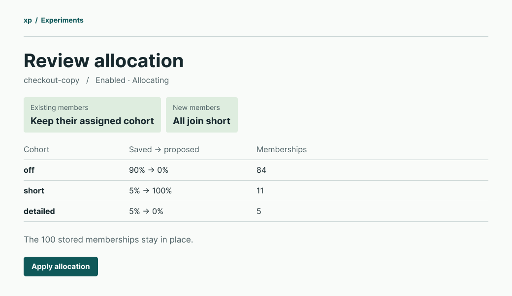
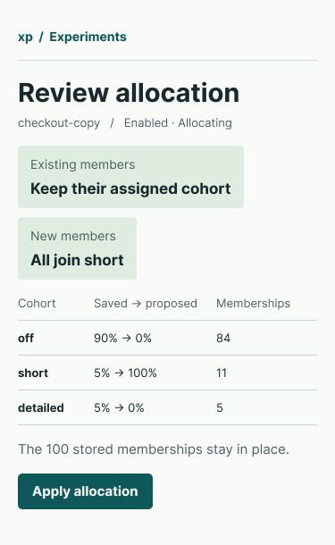
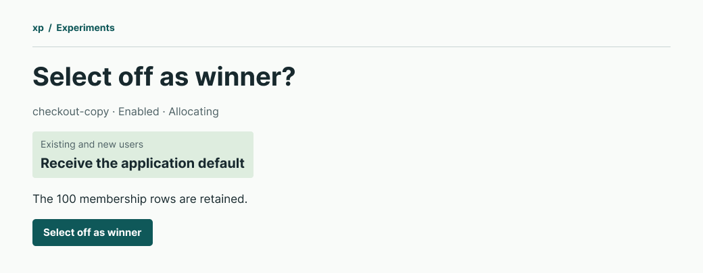

# Figma · Serving by audience

The editable proposal has 12 desktop frames and 12 mobile frames. Its review puts two questions above the cohort table. What will an existing member receive after the action? What will a new member receive? Open the [design file](https://www.figma.com/design/oa9xXti9srEmXuttWJUsfB) or step through the [desktop prototype](https://www.figma.com/proto/oa9xXti9srEmXuttWJUsfB/xp-management?node-id=1-2&starting-point-node-id=1%3A2) and [mobile prototype](https://www.figma.com/proto/oa9xXti9srEmXuttWJUsfB/xp-management?node-id=1-178&starting-point-node-id=1%3A178).

Open the [local linked-frame walkthrough](index.html) from a checkout. Its keyboard-accessible hotspots follow the native prototype through the exported desktop frames.

## Walkthrough

| Start                 | Select                                         | Outcome                                                                                                                                                                                                |
| --------------------- | ---------------------------------------------- | ------------------------------------------------------------------------------------------------------------------------------------------------------------------------------------------------------ |
| Five-record directory | Checkout copy                                  | Open the allocating definition. Read the audience outcomes first, then 90 / 5 / 5 beside 84 / 11 / 5 stored memberships.                                                                               |
| Allocating detail     | Adjust split → Apply allocation                | The review compares saved and proposed shares, row by row. Existing members keep their cohort. All new members join short.                                                                             |
| Create experiment     | Create → Launch rollout                        | The creation example begins a separate empty-installation scenario. Off is initially pinned at 100%, zero memberships exist and visitors get the default. Launch clears the pin and starts 90 / 5 / 5. |
| Allocating detail     | Pause serving → Pause serving → Resume serving | Pause and resume display the effective behavior at each step.                                                                                                                                          |
| Allocating detail     | Select winner → Select off as winner           | The final-off frame shows the selected winner, default delivery and the existing 84 / 11 / 5 membership counts.                                                                                        |

The [operator brief](../../../docs/management-design/brief.md) supplies the fixtures. The [audits](../../../docs/management-design/research.md) connect the two affected audiences to Statsig's ending guide and the separate saved and served states to Optimizely. At 375 px audience outcomes stack above the compact table. At 1040 px they are adjacent. The native frames use editable Inter text and auto-layout. Search, typing arbitrary percentages, server failures and a screen reader experience require an implemented UI. The fixed frames demonstrate the sample transitions.

## Captures

| Directory                                                | Detail                                                                                 |
| -------------------------------------------------------- | -------------------------------------------------------------------------------------- |
|  |  |

| Review on desktop                                                         | Review at 375 px                                         |
| ------------------------------------------------------------------------- | -------------------------------------------------------- |
|  |  |

## Design judgment

Adopt the audience-specific text on the split and winner confirmation screens. For a 100% proposed treatment it can name the cohort directly. A single sentence serves both audiences when pausing or selecting a winner. The directory leaves room for separate phase and availability columns on widescreen, and the detailed definition needs an edit form before review. Repeating a pair of outcome panels for every row or action would make the directory slower to scan.

These images were exported directly from the scoped Figma file on 21 November 2026. The primary desktop walkthrough uses nodes 1:2 → 1:31 → 1:81 → 1:130 and the equivalent mobile path uses 1:178 → 1:207 → 1:257 → 1:306. The launch and finalize confirmations use nodes 3:12 and 3:55. Native read-back of the primary frames confirmed their click destinations, Inter text layers and absence of flattened-image layers.
