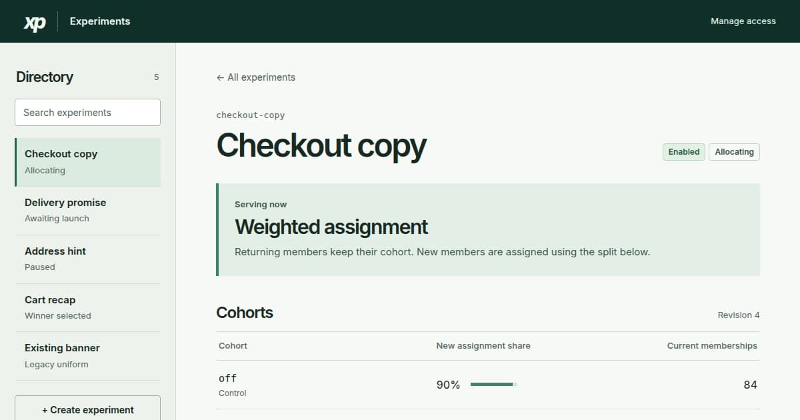

# Serving ledger

MagicPath built this responsive React proposal on November 21, 2026. The directory stays open next to the selected experiment on a desktop. On a phone, Back to all experiments returns to a dedicated directory view. The first section of detail answers the operator's question about delivery and the next section gives the denominator for each number.

| Evidence                                           | Location                                                                                                                            |
| -------------------------------------------------- | ----------------------------------------------------------------------------------------------------------------------------------- |
| Private canvas                                     | [Serving ledger project](codex://mcp-app/magicpath@personal/open_magicpath_canvas/projects/474984165029318656)                      |
| Native build                                       | Component `474984237590786048`, revision `474985582108483584`, completed job `474016740829978624-external-agent-474985983482400768` |
| Local Chromium captures of the submitted component | [Desktop](1440.png) · [Mobile](375.png) · [Distribution review](review.png)                                                         |
| Interactive source                                 | [React](src/components/generated/ServingLedger.tsx) · [Styles](src/components/generated/ServingLedger.css)                          |

## Walkthrough

From the repository root, run `bun review/experiment-management/magicpath/index.html` and open the URL printed by Bun. The query strings below select synthetic scenarios. Reloading restores the fixture data.

1. Start on Checkout copy. “Enabled” and “Allocating” identify two independent facts. Serving now explains who gets a new assignment. Read 90% future off share next to 84 current off memberships.
2. Adjust split. Change the saved 90/5/5 to 80/15/5 and choose Review changes. Each proposed amount retains its saved value for comparison. Cancel with Escape to return focus to Adjust split.
3. Visit `?empty` and create checkout-copy with treatments `short, detailed`. The detail opens with pinned off, default serving and zero stored memberships. Launch, pause, resume and select a winner. Selecting off names the final phase while retaining current counts.
4. Open `?failure=stale` and submit an edit. Review latest brings the draft back alongside the newer revision. Use `?failure=save` to exercise a transient failure. `?viewer&count-error` opens read-only detail with failed counts and a separate retry. `?no-create` hides creation for a manager.

The interaction follows the two-audience finalization review in the [Statsig audit](../../../docs/management-design/audits/statsig.md) and distinct pause and finish controls in the [PostHog audit](../../../docs/management-design/audits/posthog.md). The side directory applies the transition in [UX Pilot's preview](../ux-pilot-flow.json). xp's sticky assignment contract permits a split change for future memberships only.

## Tradeoffs

Adopt the serving explanation, the separate saved-phase label and the explicit old/new split review. A persistent sidebar makes it quick to compare neighboring experiments, but consumes room in a narrow host column and duplicates the directory destination. At 375 px the third action can fall below the first viewport. For a long directory, use server-side pagination and display both slug and name in the list. This prototype uses a fixed five-row directory and synthetic per-mount state.

Chromium exercised 375, 768, 1024 and 1440 px with no document overflow. The walkthrough included empty creation through final off, invalid totals, Escape focus return, read-only permissions, count retry and stale-revision review. A stale-review button that triggered a second submission in the first revision was corrected and retested in the revision above.
