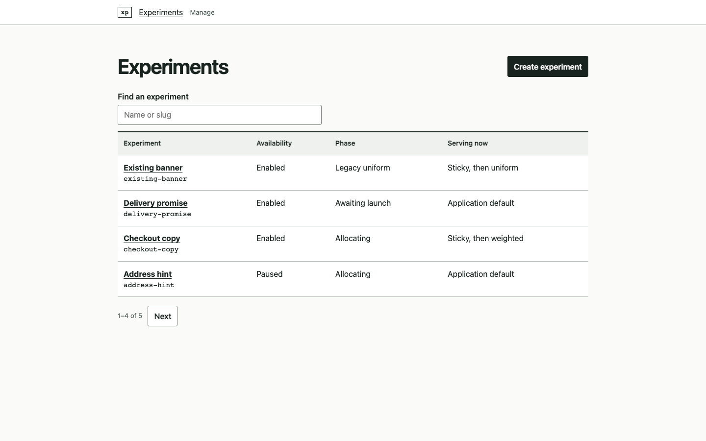
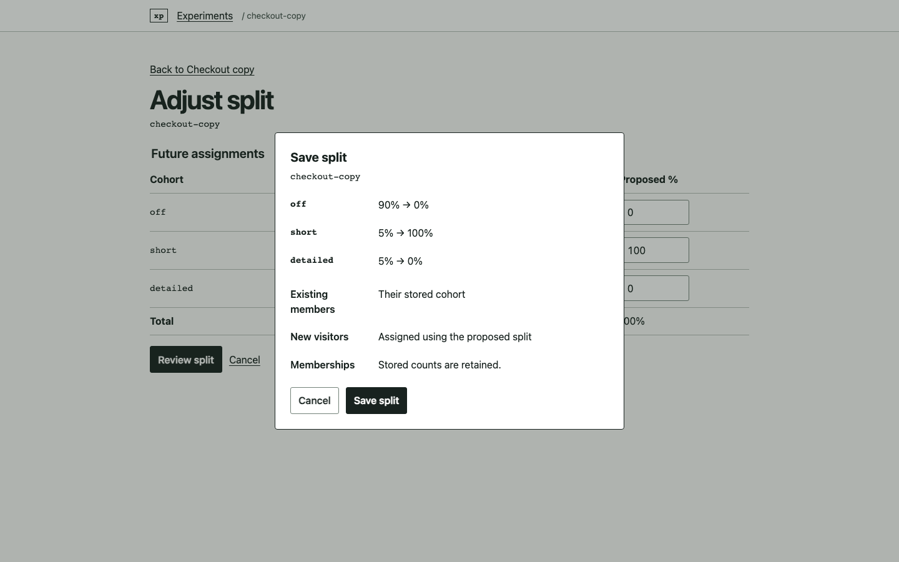
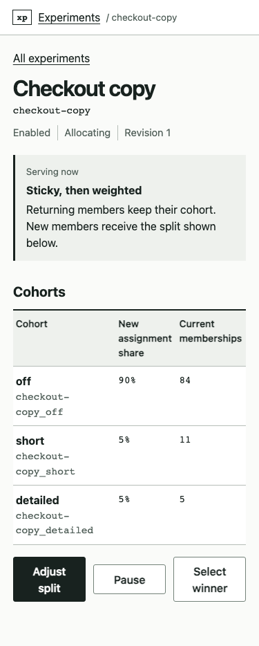

# UX Pilot · serving-first wireframes

Open [the connected wireframes](index.html) directly from a checkout. The five fixture records, role boundary, and available actions come from the [shared brief](../../../docs/management-design/brief.md). Edits apply to the open tab's synthetic store until the page reloads.

## Provenance

On 21 November 2026 UX Pilot generated a [43-node flow preview](../ux-pilot-flow.json). The native preview proposed a full-population reweight branch. xp supports reweighting future assignments only, so the local flow has one split editor. The corrected lifecycle flow is diagram `t3BYi114us4hhTRl1j14` on the [owned UX Pilot canvas](https://uxpilot.ai/a/ui-design?page=LPFGwxUfmHUPILkN4nXd). The agent added the diagram without changing existing designs. UX Pilot accepted the low-fidelity screen request on that page and opened its **Start generating** widget. The captures below are Chromium renders of the locally authored HTML translation. An xp screen export from the native generation widget still requires user interaction.

## Walkthrough

| Start                                                                                                                                                                        | Interaction and result                                                                                                                                                                         |
| ---------------------------------------------------------------------------------------------------------------------------------------------------------------------------- | ---------------------------------------------------------------------------------------------------------------------------------------------------------------------------------------------- |
| [Directory](index.html)                                                                                                                                                      | Search by name or slug or use Next to discover the remaining experiment. Availability, phase and serving each have their own column. Mobile presents the same cells in labeled rows.           |
| [Running detail](index.html#checkout-copy)                                                                                                                                   | A plain-language serving summary appears before the cohort table. Its last two columns describe future assignments and current stored rows.                                                    |
| [Empty store](index.html?empty)                                                                                                                                              | Create experiment with slug `checkout-copy` and treatments `short, detailed`. Review the saved enabled, pinned definition and zero memberships. Launch opens the complete split for review.    |
| [Adjust split](index.html#checkout-copy/split)                                                                                                                               | Change 90 / 5 / 5 to 0 / 100 / 0. Review shows every saved and proposed share followed by the effect on existing members, new visitors and counts. Cancel restores focus to the review button. |
| [Allocating](index.html#checkout-copy)                                                                                                                                       | Pause, resume, then select off as winner. Each command reviews the affected populations. The resulting detail shows Winner selected, Application default and the retained counts.              |
| [Viewer](index.html?access=view#checkout-copy) · [Creation disabled](index.html?disable-create)                                                                              | Check the read-only experience and manager permissions with host creation disabled.                                                                                                            |
| [Failed counts](index.html?error=counts#checkout-copy) · [Stale edit](index.html?error=stale#checkout-copy/split) · [Failed save](index.html?error=save#checkout-copy/split) | Retry counts, review the current revision or retry the preserved draft. Submitting an incomplete split displays an inline total error.                                                         |

## Review captures

## Tradeoffs and proposed adoption

The directory's serving column lets someone answer a support question before opening the record. At 375 px repeating these facts under each name consumes space. Use the stacked entry primarily on small screens; keep horizontal table scanning on desktop. The detail can fit in a host with a single breadcrumb and no permanent sidebar. On wider displays the summary's text-first layout leaves less room for comparing many active rollouts at once.

Adopt the two-column comparison between saved and proposed weights and the three consequence rows in confirmation. The read models already provide the facts, and a winner selection can use the same arrangement as a split change. Use a shorter review for reversible pause and resume.

Chromium verification covered directory → adjusting split → cancel and focus return → saving → pause → resume → winner off at 375, 768, 1024 and 1440 px, and separately checked creation/launch, read-only access, disabled creation and all three recovery fixtures. A 375 px detail had zero horizontal overflow.
